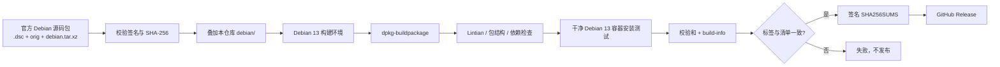

# KiCad 10 for Debian 13 (amd64)

[](https://github.com/OWNER/REPO/actions/workflows/ci.yml)
[](https://github.com/OWNER/REPO/actions/workflows/build.yml)

> 把文中的 `OWNER/REPO` 替换成实际 GitHub 仓库路径；徽章和 Release 链接不会自动解析。

从 Debian 官方 KiCad 源码包出发，在 **Debian 13 (trixie) amd64** 上使用原生
Debian 打包工具构建 `.deb`，通过 GitHub Actions 测试并由 GitHub Releases 发布。

本仓库是一个 **Debian 下游打包仓库**，不是把 KiCad 编译产物直接塞进一个不透明
压缩包的脚本集合。

> **状态**：流水线、打包配置、校验和签名与发布门禁已经实现。首次完整编译必须在
> GitHub Actions 或自建 Debian 13 VM 上跑通；任何失败都会阻止正式 Release。
> 本仓库不是 Debian 官方项目，产出的包也不是官方 Debian 包。

## 当前基线

| 项目 | 值 |
| --- | --- |
| 上游稳定版 | `10.0.7` |
| 官方 Debian 源码包 | `10.0.7+dfsg-1` (sid) |
| 下游 Debian 版本 | `10.0.7+dfsg-1+trixie1` |
| 目标系统 | Debian 13 (trixie), amd64 |
| Git 标签 | `v10.0.7` |
| 构建产物 | `kicad_10.0.7+dfsg-1+trixie1_amd64.deb` |

版本号、源码校验和和发布标签只在一个地方维护：
[`packaging/versions.env`](packaging/versions.env) 与
[`packaging/sources.sha256`](packaging/sources.sha256)。

## 这个包包含什么，不包含什么

`kicad` 二进制包包含 KiCad 应用程序、`kicad-cli`、Python `pcbnew` 模块、桌面文件、
man page 和运行时资源。

**不包含**符号库、封装库、模板和 3D 模型。它们属于 Debian 的其他源码包
（`kicad-symbols`、`kicad-footprints`、`kicad-packages3d` 等）。Debian 13 自带
的是 9.0.x 库，而 KiCad 10 在 `debian/control` 中声明 `Breaks: kicad-libraries
(<< 10.0.0~)`，因此安装本包时 apt 可能会移除旧库元包。使用原理图/PCB 前请自行
安装与 KiCad 10 匹配的库。

本仓库第一版刻意 **只构建 `kicad` 应用包**（`dpkg-buildpackage -B`），不构建
演示工程、翻译文档和语言包，以缩短 CI 时间、减小 Release 体积。需要完整构建时
可以使用 `scope=full`（见 [docs/BUILD.md](docs/BUILD.md)），但它不是默认发布门禁。

## 安装

从 GitHub Releases 下载 `.deb`、`SHA256SUMS`、`SHA256SUMS.asc` 和
`release-key.asc`，然后：

```bash
# 1. 通过独立渠道核对 release-key.asc 的指纹后导入
gpg --import release-key.asc

# 2. 校验签名和每个文件
gpg --verify SHA256SUMS.asc SHA256SUMS
sha256sum -c SHA256SUMS

# 3. 安装（apt 会解析运行时依赖）
sudo apt install ./kicad_10.0.7+dfsg-1+trixie1_amd64.deb

# 4. 验证
kicad-cli version
```

如果 apt 尝试安装 Debian 13 的 9.0.x 库并因此失败，使用：

```bash
sudo apt install --no-install-recommends ./kicad_10.0.7+dfsg-1+trixie1_amd64.deb
```

签名只能证明文件由持有该密钥的人发布。必须通过项目 README、Release 说明或其他
独立渠道核对密钥指纹，不能因为 `.asc` 和 `.deb` 放在一起就默认可信。

## 架构



构建链路和发布链路是分开的：

- `build.yml`：可手动触发，也可以在发布时被调用；只产出经过测试的 artifact，
  不直接创建 Release。
- `release.yml`：只由 `v*` 标签触发；先验证标签与源码清单完全一致，再调用构建，
  最后在受保护的 `release` Environment 中签名并发布。
- `ci.yml`：PR/push 上的快速检查（shellcheck、yamllint、actionlint、版本清单、
  打包配置来源比对、Trixie 构建依赖解析），不执行完整编译。

## 两种构建运行器

| 模式 | `runner` 输入 | 说明 |
| --- | --- | --- |
| GitHub 托管容器 | `github-hosted`（默认） | 在 Ubuntu VM 上启动 `debian:13` 容器；构建用户空间是 Debian 13，适合大多数用户 |
| 自建 Debian 13 VM | `self-hosted-vm` | 真正的 Debian 13 虚拟机/物理机；需要自建 runner，标签 `debian-13,kicad-builder` |

GitHub 托管的标准 Linux runner 不提供嵌套 KVM，用 QEMU 全软件模拟编译 KiCad
不可行。因此“Debian 13 虚拟机”通过自建 runner 实现；默认的容器模式则用
Debian 13 用户空间保证 ABI 与依赖正确。两种模式使用完全相同的脚本和测试。

自建 VM 的安装、标签、sudo 限制和安全注意事项见
[docs/SELF-HOSTED-VM.md](docs/SELF-HOSTED-VM.md)。

## 本地构建

要求 Debian 13 amd64、root/sudo、至少 7 GiB 可用磁盘（建议 20 GiB；标准
GitHub 托管 runner 只有约 14 GiB，完整发布建议自建 VM），建议 8 核和 16 GiB 内存。

```bash
sudo ./scripts/install-build-tools.sh

./scripts/fetch-source.sh
./scripts/verify-packaging-provenance.sh
./scripts/check-build-deps.sh

sudo ./scripts/install-build-deps.sh
./scripts/build-deb.sh --scope arch

./scripts/test-package.sh
./scripts/audit-package.sh
./scripts/make-checksums.sh

# 可选：在干净容器中安装/卸载（会修改系统，务必在一次性环境中运行）
sudo ./tests/package-smoke-test.sh
```

也可以使用 Makefile：

```bash
make tools          # sudo apt 安装打包工具
make source         # 下载并认证官方源码
make deps-check     # 仅解析 Trixie 构建依赖
make deps           # 安装构建依赖（sudo）
make build          # 默认 scope=arch
make test audit checksums
make smoke          # 需要 root，建议在容器/VM 中运行
```

或直接在一次性 Debian 13 容器里执行：

```bash
docker run --rm -it -v "$PWD:/work" -w /work \
  debian:13@sha256:4c25275446ca371766b8b093c696782eabce06263fccacb8d5d813b3dc44b308 \
  bash
```

完整说明、构建失败时的 Trixie 适配流程、依赖策略和可复现性限制见
[docs/BUILD.md](docs/BUILD.md)。

## 仓库结构

```text
.
├── .github/
│   ├── actions/build-deb/       # 可复用的构建、测试、审计步骤
│   ├── workflows/
│   │   ├── ci.yml               # PR/push 快速检查
│   │   ├── build.yml            # 可复用/手动构建，不发布
│   │   └── release.yml          # 标签触发、构建、签名、发布
│   ├── actionlint.yaml
│   └── dependabot.yml
├── debian/                      # 官方 Debian 打包 + 下游 changelog 条目
├── docs/
│   ├── BUILD.md
│   ├── RELEASE.md
│   ├── SECURITY.md
│   └── SELF-HOSTED-VM.md
├── packaging/
│   ├── versions.env             # 唯一版本清单
│   ├── sources.sha256           # 官方源码 SHA-256
│   └── allowed-packaging-diff.txt
├── scripts/                     # 下载、构建、测试、审计、签名
├── tests/                       # 依赖/文件布局检查、干净容器冒烟测试
├── Makefile
└── README.md
```

## 供应链与来源验证

`debian/` 不是随手写的最小打包配置，而是 Debian sid 官方
`10.0.7+dfsg-1` 的打包目录。CI 会：

1. 下载官方 `.dsc`、`.orig.tar.xz`、`.orig-doc.tar.xz`、`.debian.tar.xz`；
2. 用提交在仓库中的 SHA-256 校验每个文件；
3. 用 `debian-keyring` 验证 `.dsc` 的 Debian 开发者签名；
4. 用 `dscverify` 交叉校验源码包；
5. 把 `debian/` 与官方 `.debian.tar.xz` 逐文件、逐权限比对，只允许
   `debian/changelog` 不同，并要求官方 changelog 是当前 changelog 的**精确后缀**。

构建环境 **不添加 sid 二进制仓库**。`apt-get build-dep` 只从 Debian 13 解析
`Build-Depends`；若 Trixie 不满足版本要求，流水线失败，维护者必须评估补丁、
单独打包依赖或暂缓发布，而不是删除依赖或关闭 ABI 检查。

## 发布与签名

发布只允许由与 `packaging/versions.env` 中 `RELEASE_TAG` 完全一致的标签触发。
`v10.0.8` 之类的标签不会让流水线继续使用 10.0.7 源码。

发布 job 使用 GitHub Environment `release`，应配置人工审批和标签保护。签名密钥只
保存在 Environment secret 中；公钥指纹通过 repository variable
`RELEASE_KEY_FINGERPRINT` 固定，并在签名前强制比对。

详细发布清单、密钥生成/轮换、标签规则和回滚策略见
[docs/RELEASE.md](docs/RELEASE.md)。

## 已知限制

- 仅 amd64，仅 Debian 13；不保证在 testing/unstable、Ubuntu 或其他架构上运行。
- 不包含 KiCad 符号/封装/3D 库；Trixie 的 9.0.x 库与 KiCad 10 不兼容。
- 无自动更新机制；升级需手动下载新 Release。
- CI 不启动 GUI（无显示服务器），只做 CLI、Python 模块、桌面文件、安装/卸载测试。
- 首次完整编译和所有 Trixie 兼容性问题仍需由真实 CI 运行确认；静态检查不能替代
  编译。
- 产物尚未由独立的可复现构建验证；`build-info.json` 记录源码摘要与构建环境，
  便于后续比对。

## 安全

请阅读 [docs/SECURITY.md](docs/SECURITY.md)。安全问题请通过 GitHub Security
Advisories 私下报告，不要在公开 issue 中粘贴签名私钥、token 或未修复漏洞细节。

## 许可

本仓库新增的脚本、工作流和文档使用 MIT 许可，见 [LICENSE](LICENSE)。
`debian/` 目录保留 Debian 官方打包的版权与许可；KiCad 源码本身遵循其上游许可。
