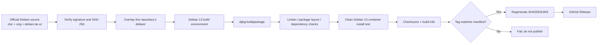

# KiCad 10 for Debian 13 (amd64)

**English** | [简体中文](README.zh-CN.md)

[](https://github.com/OWNER/REPO/actions/workflows/ci.yml)
[](https://github.com/OWNER/REPO/actions/workflows/build.yml)

> Replace `OWNER/REPO` with the actual GitHub repository path. Badges and release
> links do not resolve automatically.

This repository builds a Debian `.deb` from the **official Debian KiCad source
package** on **Debian 13 (trixie) amd64**, using native Debian packaging tools.
GitHub Actions builds and tests the package; GitHub Releases publishes only a
tested artifact.

It is a **Debian downstream packaging repository**, not a script that compiles
KiCad and wraps the result in an opaque archive.

> **Status:** the pipeline, packaging configuration, checksum handling,
> and release gates are implemented. The first full compilation must pass in
> GitHub Actions or on a self-hosted Debian 13 VM; any failure blocks a formal
> release. This is not an official Debian project, and the resulting package is
> not an official Debian package.

> **Version note:** Debian sid currently packages `10.0.7+dfsg-1`. There is no
> Debian `10.7` source package; this repository pins the actual current stable
> release, `10.0.7`.

## Current baseline

| Item | Value |
| --- | --- |
| Upstream stable release | `10.0.7` |
| Official Debian source | `10.0.7+dfsg-1` (sid) |
| Downstream Debian version | `10.0.7+dfsg-1+trixie1` |
| Target | Debian 13 (trixie), amd64 |
| Git tag | `v10.0.7` |
| Main artifact | `kicad_10.0.7+dfsg-1+trixie1_amd64.deb` |

Versions, source checksums, and the release tag are maintained in one place:
[`packaging/versions.env`](packaging/versions.env) and
[`packaging/sources.sha256`](packaging/sources.sha256).

## What the package contains

The `kicad` binary package contains the KiCad application, `kicad-cli`, the
Python `pcbnew` module, desktop files, man pages, and runtime resources.

It **does not contain** symbol, footprint, template, or 3D-model libraries.
Those are separate Debian source packages (`kicad-symbols`,
`kicad-footprints`, `kicad-packages3d`, and so on). Debian 13 ships 9.0.x
libraries, and KiCad 10 declares `Breaks: kicad-libraries (<< 10.0.0~)` in
`debian/control`; installing this package may therefore remove the old library
metapackage. Install KiCad 10-compatible libraries separately before opening
projects that need them.

The first version deliberately **builds only the `kicad` application package**
(`dpkg-buildpackage -B`). It does not build demos, translated documentation, or
language packages, keeping CI time and release size under control. A full build
is available with `scope=full` (see [docs/BUILD.md](docs/BUILD.md)), but it is
not the default release gate.

## Install

Download the `.deb` and `SHA256SUMS` from GitHub Releases, then:

```bash
# 1. Verify every downloaded file against the checksum file
sha256sum -c SHA256SUMS

# 2. Install; apt resolves the runtime dependencies
sudo apt install ./kicad_10.0.7+dfsg-1+trixie1_amd64.deb

# 3. Verify
kicad-cli version
```

If apt tries to install Debian 13's 9.0.x library packages and fails, use:

```bash
sudo apt install --no-install-recommends ./kicad_10.0.7+dfsg-1+trixie1_amd64.deb
```

These releases are **unsigned**. `SHA256SUMS` detects corruption and accidental
modification, but it does not prove who published the files. For authenticity,
obtain the checksum file through an independent trusted channel.

## Architecture



Build and publication are separate chains:

- `build.yml`: manually dispatchable or called by the release workflow; produces
  tested artifacts and never creates a GitHub Release itself.
- `release.yml`: triggered only by a `v*` tag. It verifies that the tag exactly
  matches the source manifest, calls the build, and publishes from a protected
  `release` environment.
- `ci.yml`: fast PR/push checks (shellcheck, yamllint, actionlint, version
  manifest, packaging provenance, Trixie Build-Depends resolution). It does not
  perform a full build.

## Build runners

| Mode | `runner` input | Description |
| --- | --- | --- |
| GitHub-hosted container | `github-hosted` (default) | Starts a `debian:13` container on an Ubuntu VM; the build userland is Debian 13 |
| Self-hosted Debian 13 VM | `self-hosted-vm` | A real Debian 13 VM or physical machine; requires a runner labeled `debian-13,kicad-builder` |

Standard GitHub-hosted Linux runners do not provide nested KVM, so compiling
KiCad under full QEMU software emulation is not practical. A true Debian 13
virtual machine is therefore provided through a self-hosted runner, while the
default container mode uses a Debian 13 userland to keep the ABI and dependency
resolution correct. Both modes run the same scripts and tests.

See [docs/SELF-HOSTED-VM.md](docs/SELF-HOSTED-VM.md) for runner installation,
labels, sudo restrictions, and security hardening.

## Local build

Requirements: Debian 13 amd64, root/sudo, at least 7 GiB free disk (20 GiB
recommended; a standard GitHub-hosted runner has only about 14 GiB, so use a VM
for reliable releases), and preferably 8 cores and 16 GiB RAM.

```bash
sudo ./scripts/install-build-tools.sh

./scripts/fetch-source.sh
./scripts/verify-packaging-provenance.sh
./scripts/check-build-deps.sh

sudo ./scripts/install-build-deps.sh
./scripts/build-deb.sh --scope arch

./scripts/test-package.sh
./scripts/audit-package.sh
./scripts/make-checksums.sh

# Optional: install/uninstall in a clean environment
# (this modifies the system; run only in a disposable container or VM)
sudo ./tests/package-smoke-test.sh
```

Or use the Makefile:

```bash
make tools          # install packaging tools with sudo apt
make source         # download and authenticate the official source
make deps-check     # resolve Trixie Build-Depends only
make deps           # install Build-Depends (sudo)
make build          # default scope=arch
make test audit checksums
make smoke          # needs root; run in a disposable environment
```

Or open a disposable Debian 13 container:

```bash
docker run --rm -it -v "$PWD:/work" -w /work \
  debian:13@sha256:4c25275446ca371766b8b093c696782eabce06263fccacb8d5d813b3dc44b308 \
  bash
```

For the full build procedure, the Trixie adaptation workflow when compilation
fails, the dependency policy, and reproducibility limitations, see
[docs/BUILD.md](docs/BUILD.md).

## Repository layout

```text
.
├── .github/
│   ├── actions/build-deb/       # reusable build, test, and audit steps
│   ├── workflows/
│   │   ├── ci.yml               # fast PR/push checks
│   │   ├── build.yml            # reusable/manual build; never publishes
│   │   └── release.yml          # tag-triggered build and publish
│   ├── actionlint.yaml
│   └── dependabot.yml
├── debian/                      # official Debian packaging + downstream changelog
├── docs/
│   ├── BUILD.md
│   ├── RELEASE.md
│   ├── SECURITY.md
│   └── SELF-HOSTED-VM.md
├── packaging/
│   ├── versions.env             # single source of truth for versions
│   ├── sources.sha256           # official source SHA-256 digests
│   └── allowed-packaging-diff.txt
├── scripts/                     # download, build, test, audit, checksums
├── tests/                       # dependency/layout checks, clean-container smoke test
├── Makefile
├── README.md
└── README.zh-CN.md
```

## Supply-chain and source verification

`debian/` is not a hand-written minimal packaging directory. It is the official
Debian sid `10.0.7+dfsg-1` packaging. CI will:

1. Download the official `.dsc`, `.orig.tar.xz`, `.orig-doc.tar.xz`, and
   `.debian.tar.xz`.
2. Verify every file against SHA-256 digests committed to this repository.
3. Verify the Debian developer signature on the `.dsc` with `debian-keyring`.
4. Cross-check the source package with `dscverify`.
5. Compare `debian/` with the official `.debian.tar.xz` file by file and mode by
   mode. Only `debian/changelog` may differ, and the official changelog must be
   an exact suffix of the current changelog.

The build environment **does not add a sid binary repository**. `apt-get
build-dep` resolves `Build-Depends` from Debian 13 only. If Trixie cannot satisfy
a version, the pipeline fails and a maintainer must decide whether to patch,
backport a dependency, or defer the release. Removing dependencies or disabling
ABI checks to make CI green is not acceptable.

## Release and checksums

A release can only be triggered by a tag that exactly matches `RELEASE_TAG` in
`packaging/versions.env`. A tag such as `v10.0.8` cannot make the pipeline
publish the 10.0.7 source under a new version.

The publish job uses the GitHub `release` environment, which should require
manual approval and tag protection. Releases are **unsigned**: no GPG key,
secret, or fingerprint is required. The workflow regenerates `SHA256SUMS` after
adding the release notes and smoke-test report, verifies it, and uploads it with
the `.deb`.

For the release checklist, checksum policy, tag rules, and rollback policy, see
[docs/RELEASE.md](docs/RELEASE.md).

## Known limitations

- amd64 and Debian 13 only; Debian testing/unstable, Ubuntu, and other
  architectures are not supported.
- Symbol, footprint, and 3D-model libraries are not included. Trixie's 9.0.x
  libraries are incompatible with KiCad 10.
- There is no automatic update mechanism; download a newer release to upgrade.
- CI does not start the GUI (there is no display server). It tests the CLI, the
  Python module, desktop files, and install/uninstall behavior.
- The first full compilation and any Trixie compatibility issues still need to
  be confirmed by a real CI run; static checks cannot replace compilation.
- Releases are unsigned. Checksums detect corruption but do not provide
  cryptographic publisher authenticity.
- The output has not yet been independently reproduced. `build-info.json`
  records source digests and the build environment to support later comparison.

## Security

Read [docs/SECURITY.md](docs/SECURITY.md). Report security issues privately through
GitHub Security Advisories. Do not paste tokens or unpatched
vulnerability details into public issues.

## License

The scripts, workflows, and documentation added by this repository are MIT
licensed; see [LICENSE](LICENSE). The `debian/` directory retains the Debian
packaging copyright and license. KiCad itself follows its upstream licenses.
